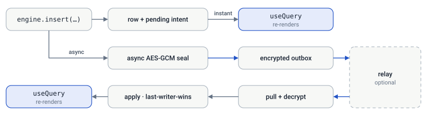

# Client API

This is everything an app developer touches: define a typed schema, create the
engine, read and write data, bind it into React, and connect a relay. The engine
(`@simplysync/engine`) owns the local SQLite database, the outbox, the clock, and
the sync loop — you write app code, not plumbing.

For what happens beneath this API, see **[How it works](./architecture.md)** (the
on-device store, clock, and read/write paths) and
**[Sync & the relay](./sync.md)** (the encrypted envelope, the wire protocol, the
relay).

> **Looking something up?** Jump to the [API reference](#api-reference) or [Common pitfalls](#common-pitfalls).

## Mental model

- **The local SQLite database is the source of truth.** Reads come from it;
  writes land in it first. The app is fully usable offline.
- **Every normal engine-stamped write also produces a durable replication
  intent.** The row and plaintext-pending outbox marker commit together; the
  engine seals that marker into an encrypted event asynchronously before any
  relay push. Caller-supplied HLCs must be unique per emitted event.
- **Sync is automatic and opportunistic.** The engine polls, pushes the outbox,
  pulls remote events, decrypts them, and applies them last-writer-wins. You
  rarely call `sync()` yourself.
- **Queries are reactive.** A `useQuery` re-renders when the rows it depends on
  change — whether the change came from a local write or an incoming sync.



## Setup

### Clone the client source

SimplySync is clone-only. Start with the platform you need; the command includes
its transitive source dependencies and omits the other client implementations:

```sh
# Browser / React
sh clone-simplysync.sh web my-web-app

# React Native / Expo
sh clone-simplysync.sh react-native my-mobile-app

# Bun CLI
sh clone-simplysync.sh cli my-cli-app
```

From an empty directory, pipe the same script from
`https://raw.githubusercontent.com/simply-hq/simplysync/main/clone-simplysync.sh`.
From a full checkout, use `bun run clone <preset> <destination>`.

Use `@simplysync/engine` without the React source module in another UI
framework. `@simplysync/browser` supplies the sql.js/IndexedDB database and
encrypted browser secret storage; React Native injects its platform SQLite and
secure storage adapters through `@simplysync/react-native`.

The selected repository keeps these packages connected through Bun workspaces:

```jsonc
// package.json
{
  "dependencies": {
    "@simplysync/engine": "workspace:*",
    "@simplysync/browser": "workspace:*",
    "@simplysync/react": "workspace:*",
    "@simplysync/react-native": "workspace:*",
    "@simplysync/node": "workspace:*"
  }
}
```

Run `bun install --no-save` in a selective clone, then `bun run build`. Use
`bun install --frozen-lockfile` in a full checkout. The no-save form preserves
the full-repository lockfile while intentionally omitted workspaces are absent.

**Runtime requirements:** the engine needs WebCrypto (`globalThis.crypto.subtle`)
and `btoa`/`atob`. These exist in modern browsers, Node 20+, and Bun. In React
Native they do not exist by default. Install the peer dependencies listed by
`@simplysync/react-native`, then import
`@simplysync/react-native/install` *before* the engine; see the
[package guide](../../packages/simplysync-react-native).

### Define a schema

A schema is a plain `{ table: { column: Type } }` object. Column types come from
the engine's small typed-schema DSL and double as runtime validators.

```ts
import { FiniteNumber, id, NonEmptyString, nullOr } from "@simplysync/engine";

export const schema = {
  category: {
    id: id("category"),
    name: NonEmptyString,
  },
  entry: {
    id: id("entry"),
    description: NonEmptyString,
    amountCents: FiniteNumber,
    categoryId: nullOr(id("category")), // nullable foreign key
  },
};

export type AppSchema = typeof schema;
```

You declare `id` per table. The engine adds three **system columns** to every
table automatically: `createdAt`, `updatedAt` (both ISO strings), and
`isDeleted` (a `0 | 1` SQLite boolean). You never write the physical `CREATE
TABLE` — the engine derives it from the schema.

**Built-in column types:** `String`, `NonEmptyString`, `NonEmptyString1000`,
`PositiveInt`, `FiniteNumber`, `SqliteBoolean`, `SimpleName`, `Mnemonic`, and
`id("Table")`. Wrap any of them with `nullOr(...)` to allow `null`, or
`maxLength(n)(...)` to bound a string. Each type validates on write and rejects
bad values with a typed error.

### Create the engine

`createSync(deps)` takes the platform plumbing once, then returns a factory you
call with your schema and config.

```ts
import { createSync } from "@simplysync/engine";

const engine = createSync({
  createSqliteDriver, // (name) => SqliteDriver — platform SQLite (see Platform drivers)
  secureStorage,      // stores the recovery key/phrase in the OS secret store (see Platform drivers)
  reloadApp,          // optional: re-evaluate app state after restore/reset
})(schema, {
  name: "my-app",
  transports: [], // local-only until you add a relay
  syncIntervalMs: 5000, // poll cadence; default 5000
  schemaVersion: 1,     // optional; defaults to 1
});

await engine.ready; // resolves once the DB is open and the owner is loaded
```

Keep `schemaVersion` at `1` for additive table and column changes. Only bump it
when the meaning of a payload changes incompatibly. An older app will then keep
the newer event in `_sync_deferred` without partially applying it; after an
upgrade declares the higher version, startup replays the retained event.

On first run the engine mints a new owner (a fresh BIP39 recovery phrase, stored via
`secureStorage`). On later runs it loads the existing one. Pass
`externalAppOwner` to supply an owner you derived yourself instead.

### Platform drivers

The engine is platform-agnostic: you inject a SQLite driver and a secret store.

**`SqliteDriver`** — a thin synchronous wrapper over the platform's SQLite:

```ts
interface SqliteDriver {
  exec(sql: string, params?: readonly unknown[]): void;
  select<R>(sql: string, params?: readonly unknown[]): R[];
  transaction<T>(fn: () => T): T;
}
```

- **Web:** `sql.js` (WASM) is what the browser [Demo](../../apps/docs)
  uses — see its
  [bootstrap wiring](../../apps/todolist/web/main.tsx).
- **React Native:** use `createExpoSyncDeps()` from
  [`@simplysync/react-native`](../../packages/simplysync-react-native). It
  supplies Expo SQLite, SecureStore, native PBKDF2, optional SQLCipher key
  management, and foreground sync. The canonical
  [Expo todo UI](../../apps/todolist/expo) is the complete wiring.
- **Node / Raycast / CLI:** use `createNodeSyncDeps()` from
  [`@simplysync/node`](../../packages/simplysync-node). It uses the built-in
  `node:sqlite` module, manages named connections, and accepts a host-encrypted
  secret store such as Raycast `LocalStorage`.

**`SecureStorage`** — stores the recovery key or phrase in the OS secret store:

```ts
interface SecureStorage {
  getItem(key: string): Promise<string | null> | string | null;
  setItem(key: string, value: string): Promise<void> | void;
  removeItem(key: string): Promise<void> | void;
}
```

- **React Native:** `createExpoSyncDeps()` uses `expo-secure-store`.
- **Web:** a password-derived key or a platform credential store. Avoid
  `localStorage` for anything beyond a demo.

## State management

### Writing data

Mutations are synchronous against local SQLite and return a `MutationResult`.
Each one also enqueues an encrypted envelope for sync — you don't manage that.

```ts
// insert — the engine generates the id and system columns
const result = engine.insert("entry", {
  description: "Coffee",
  amountCents: -450,
  categoryId: null,
});
if (!result.ok) console.error(result.error.message);
else console.log(result.value.id);

// update — requires the id; updates only the fields you pass
engine.update("entry", { id, amountCents: -500 });

// upsert — insert or update by id
engine.upsert("entry", { id, description: "Latte", amountCents: -500 });
```

**Deletes are soft.** In a distributed log you can't truly delete one change —
you mark the row deleted and let the tombstone sync. Use `delete`; never hard-delete
a row yourself, or peers resurrect it on the next pull.

```ts
engine.delete("entry", id);            // soft delete, idempotent
engine.deleteMany("entry", [a, b, c]); // one atomic batch
```

Deleted rows stay in the table, so queries must filter them out — see [Querying data](#querying-data).

**Write many rows atomically** with `batch`: one transaction, one query refresh,
one sync. Every op is validated first, so one bad op aborts the whole batch.
Mixing in `mode: "delete"` makes moves atomic.

```ts
const result = engine.batch([
  { table: "entry", values: { description: "Rent", amountCents: -120000 } },
  { table: "entry", values: { description: "Salary", amountCents: 300000 } },
]);
```

Inserts allow partial values (omitted columns are left `NULL`); updates require
the `id`. Values are validated against the schema, so an invalid write returns
`{ ok: false, error }` rather than corrupting the row.

**Reclaiming space.** Tombstones are kept so the deletion can replicate.
`purgeDeleted()` and `purgeRows()` reclaim them only in a database that has
never used a relay. Once relay history exists they return `{ purged: 0 }`, even
after transports are detached: without a durable cross-device deletion
watermark, hard-deleting the tombstone could let a long-offline device
resurrect the row.

### Querying data

Build a query once with `createQuery` using the full [Kysely](https://kysely.dev)
builder — joins, filters, ordering, aggregates. The compiled SQL is reused, and
the row type is inferred.

```ts
import type { Query } from "@simplysync/engine";

type EntryRow = {
  id: string;
  description: string;
  amountCents: number;
  categoryName: string | null;
};

const entriesQuery: Query<EntryRow> = engine.createQuery((db) =>
  db
    .selectFrom("entry")
    .leftJoin("category", "category.id", "entry.categoryId")
    .select([
      "entry.id as id",
      "entry.description as description",
      "entry.amountCents as amountCents",
      "category.name as categoryName",
    ])
    .where("entry.isDeleted", "=", 0)
    .orderBy("entry.createdAt", "desc"),
);
```

Read it imperatively, or (preferably) reactively in React ([React bindings](#react-bindings)):

```ts
const rows = await engine.loadQuery(entriesQuery); // one-shot read
const rows = engine.getQueryRows(entriesQuery);    // cached snapshot (sync)
```

**Always filter `isDeleted`.** Soft-deleted rows stay in their table, so a query
without `.where("isDeleted", "=", 0)` silently returns deleted rows. `createQuery`
warns once per query when the filter is missing. For a query that intentionally
reads tombstones (a trash view, a diagnostic), acknowledge it instead:

```ts
engine.createQuery(
  (db) => db.selectFrom("entry").select(["id", "isDeleted"]),
  { includeDeleted: true }, // silences the warning; does not change the SQL
);
```

### React bindings

`@simplysync/react` wires the engine into components. Wrap your tree in a
`SyncProvider`, then read the engine with `useSync` and rows with the reactive
`useQuery`.

```tsx
import {
  SyncProvider,
  useSync,
  useQuery,
  useSyncState,
} from "@simplysync/react";

function App() {
  return (
    <SyncProvider value={engine}>
      <Ledger />
    </SyncProvider>
  );
}

function Ledger() {
  const engine = useSync<AppSchema>();
  const entries = useQuery(entriesQuery); // re-renders on any relevant change
  const state = useSyncState();

  return (
    <>
      <SyncBadge state={state} />
      <button onClick={() => engine.insert("entry", { description: "Tea", amountCents: -300 })}>
        Add
      </button>
      <ul>
        {entries.map((e) => (
          <li key={e.id}>{e.description}: {e.amountCents}</li>
        ))}
      </ul>
    </>
  );
}
```

- **`useQuery(query)`** — subscribes to the query and returns the current rows.
  Re-renders when matching rows change, from a local write *or* an incoming sync.
- **`useSyncState()`** — the current `SyncState` (see [Syncing with a relay](#syncing-with-a-relay)).
- **`useSyncError()`** — the last `SyncError | null`, for surfacing failures.
- **`useSync<S>()`** — the engine instance, for mutations and `engine.sync()`.

## Identity management

### The owner & recovery key

A user's whole account derives from one secret. The engine manages it through
`secureStorage` and exposes the owner:

```ts
const owner = await engine.appOwner; // AppOwner | null
owner.id;       // public owner id used for relay routing
owner.recoveryKey; // the secret to back up — a BIP39 phrase, or a legacy sf1_ key
owner.mnemonic; // the phrase when phrase-backed; undefined for an sf1_ owner
owner.writeKey; // bearer token presented to the relay (a capability)
```

Surface `owner.recoveryKey` during onboarding so the user can save it. It is the
**only** thing that can decrypt their data — if they lose it, the data is
unrecoverable by design. Never store it in app state or plain SQLite; the engine
keeps it in the platform secret store.

### Restore on a new device

Boot with the saved key or phrase and sync from scratch:

```ts
await engine.restoreAppOwner(recoveryKey);
// By default this refuses to wipe local data unless the relay confirms the owner
// has data — so a wrong key/phrase or unreachable relay can't destroy what's here.
// Pass { force: true } to switch to an empty/new owner intentionally.
await engine.restoreAppOwner(recoveryKey, { force: true });
```

### Reset to a new owner

Reset mints a brand-new owner and wipes local data. It is the most
destructive call in the engine — the new owner has never synced anywhere, so
there is no relay to pull the old data back from. It therefore refuses by
default unless a relay is verified to hold a copy, and the error says which
condition failed so you can offer the right next step:

```ts
try {
  await engine.resetAppOwner();
} catch (error) {
  // Unpushed changes / offline / no relay configured / relay holds nothing.
  // Show `error.message`, offer a backup, and only then reset for real.
  await engine.exportDatabase(); // hand the user the file first
  await engine.resetAppOwner({ force: true });
}
```

Both `restoreAppOwner` and `resetAppOwner` call your `reloadApp` afterward so the
UI re-evaluates against the new owner.

### Back up to a file

`exportDatabase()` builds the file a user carries to a new main device without
relying on a relay: every app table plus the recovery key and sync cursors,
encrypted. File I/O (download, share sheet) stays with you.

```ts
const backup = await engine.exportDatabase(); // keyed by the recovery key
const sealed = await engine.exportDatabase({ passphrase }); // a separate secret

await engine.importDatabase(backup, { recoveryKey }); // or { passphrase }
```

By default the file is encrypted with a key derived from the owner's recovery
key, so restoring needs nothing new. `{ passphrase }` protects it with a separate
secret instead — one that survives losing the recovery key. `importDatabase`
adopts the backup's identity and **replaces** all local data; the file itself
proves ownership, so no relay is consulted. Outbox state and blob bytes are not
included, so pause writes and sync for a self-consistent export.

## Syncing with a relay

### Connecting a relay & sync state

A relay is **optional** — without one, the app is purely local-first and every
edit stays on-device. Configure one (or several) via `transports`, either at
creation or at runtime:

```ts
engine.setTransports([{ url: "https://relay.example.com" }]);
```

Setting transports triggers an immediate sync and starts the background poller.
You can still force a sync (e.g. on a "Sync now" button):

```ts
await engine.sync(); // push the outbox, then pull + apply remote events
```

`await engine.sync()` resolves once a pass that covers your writes has finished,
including when it waits for a pass already in flight. Relay failures are usually
reported through sync state/status rather than thrown. For multi-relay delivery,
`getPendingOutboxCount() === 0` means every retained event reached at least one
relay—not that every configured relay acknowledged it—so inspect
`getSyncState()` and `getRelayStatuses()` before a script declares success.

**Stopping the engine.** A short-lived process (a CLI, a script, a test) calls
`engine.close()` when it is done. That stops the sync poller, removes the web
focus/online listeners, and turns later `sync()` calls into no-ops, so the
process can exit. Local reads and writes keep working. Long-running apps never
need this. See `apps/todolist/cli/src` for a CLI that does it.

**Request deadline.** Every relay request has a deadline, 60 seconds by default
(`requestTimeoutMs`). A request past it fails that pass with kind `"timeout"`
and the next sync retries. Without it, one stalled connection would leave the
engine "syncing" forever.

**Subscriber errors.** A listener passed to `subscribeSyncState`,
`subscribeError`, or `subscribeQuery` that throws is logged with
`console.error`. It does not fail the write or sync pass that triggered it.

The engine also syncs opportunistically after local writes and on web
focus/online. Watch progress with `useSyncState()`:

| `SyncState.type` | Meaning |
| --- | --- |
| `SyncStateInitial` | Idle, nothing synced yet. |
| `SyncStateIsSyncing` | A push/pull is in flight. |
| `SyncStateIsSynced` | Up to date (`lastSyncedAt` set). |
| `SyncStateIsNotSynced` | Failed (`error`, optional `status`, and `terminal`). |

A **terminal** failure (auth/quota/bad request — 400/401/403/413) won't fix
itself by retrying the same batch, so the engine backs the poller off (but still
retries on focus/online/write). A nonterminal `429` uses the same five-minute
backoff; network and 5xx errors retry at the normal cadence.

### Multiple relays, per-relay status & storage usage

`setTransports` accepts any number of relays; every one receives a full copy of
the outbox (write redundancy) and is pulled independently. `SyncState` stays
`Synced` as long as **any** relay works — the data is safe somewhere — so for
the per-relay truth (which relay is failing, and how full each one is) use
`getRelayStatuses()`:

```ts
const statuses = await engine.getRelayStatuses(); // one HTTP probe per relay
for (const s of statuses) {
  console.log(s.url, s.reachable, `${s.usedBytes} / ${s.quotaBytes} bytes`);
}
```

Each `RelayStatus` combines this device's last sync outcome (`lastSyncedAt`,
`lastFailure`) with the relay-reported account snapshot from `GET /v1/status`:
`usedBytes` / `quotaBytes` / `usedPct` (storage against the relay's per-owner
quota — warn the user well before a `413`), plus `headSeq`, `streams`, `events`
and the relay `version`. A relay that has never seen this owner reports
`reachable: true` with no account block. Poll it at UI cadence (a diagnostics
or settings screen), not per frame.

`reseeding: true` means that relay **lost its data** — a wiped volume, a fresh
deploy, or a restore from an older backup — and this device is re-uploading the
owner's rows to rebuild it. The engine detects it two ways (a pull `404` for an
owner it had already pulled, or a reported `headSeq` behind its own pull cursor),
resets its cursor, and re-seeds automatically; without that, the relay's restarted
`seq` counter would sit below the cursor and every later pull would match nothing
while the app still showed "synced". Surface it with
`SyncStateIsSyncing.progress.pendingPush` as a "re-uploading N changes" banner —
until it clears, other devices are not receiving your edits.

Use the HTTPS URL printed by the [Cloudflare relay setup](./self-hosting.md) on
every platform.

## API reference

### Lifecycle

Build the engine, wait for it to open, and shut it down.

| Member | Signature | Notes |
| --- | --- | --- |
| `createSync` | `(deps) => (schema, config) => SyncEngine` | Wire platform deps once, then build engines. |
| `engine.ready` | `Promise<void>` | Resolves when the DB is open and owner loaded. |
| `engine.close` | `() => void` | Stop the poller, listeners, and further syncs. Idempotent; local writes still work. |

### State

Writes land in the local database and sync on their own; queries read it.

| Member | Signature | Notes |
| --- | --- | --- |
| `engine.insert` | `(table, values, opts?) => MutationResult` | Generates id + system columns. |
| `engine.update` | `(table, values & { id }, opts?) => MutationResult` | Updates passed fields only. |
| `engine.upsert` | `(table, values & { id }, opts?) => MutationResult` | Insert or update by id. |
| `engine.delete` | `(table, id, opts?) => MutationResult` | Soft-delete one row (replicating tombstone). Idempotent. |
| `engine.deleteMany` | `(table, ids, opts?) => BatchResult` | Soft-delete many rows of one table atomically. |
| `engine.batch` | `(ops, opts?) => BatchResult` | Many writes in one transaction, refresh, and sync. All-or-nothing. |
| `engine.purgeDeleted` | `({ olderThanMs? }?) => { purged }` | Hard-delete tombstones past the grace window (default 30 days). |
| `engine.purgeRows` | `(rows) => { purged }` | "Delete permanently" for specific tombstones; best-effort across devices. |
| `engine.createQuery` | `((db) => Compilable<O>, opts?) => Query<O>` | Build a reusable Kysely query. Warns on a missing `isDeleted` filter unless `{ includeDeleted: true }`. |
| `engine.loadQuery` | `(query) => Promise<readonly R[]>` | One-shot async read. |
| `engine.getQueryRows` | `(query) => readonly R[]` | Cached snapshot (sync). |
| `engine.subscribeQuery` | `(query) => (listener) => unsubscribe` | Low-level reactive primitive (`useQuery` wraps it). |

### Identity

The owner, its recovery key, and moving it between devices.

| Member | Signature | Notes |
| --- | --- | --- |
| `engine.appOwner` | `Promise<AppOwner \| null>` | `{ id, recoveryKey, mnemonic?, writeKey }`. |
| `engine.restoreAppOwner` | `(recoveryKey, { force? }) => Promise<void>` | Restore from an `sf1_` key or BIP39 phrase. |
| `engine.resetAppOwner` | `({ force? }) => Promise<void>` | New owner, wipes local data. Refuses unless a relay is confirmed to hold a copy. |
| `engine.exportDatabase` | `({ passphrase? }?) => Promise<EncryptedEnvelopeV1>` | Encrypted application-state snapshot: app rows + metadata, not outbox state or blob chunk bytes. Pause writes/sync for a self-consistent export. |
| `engine.importDatabase` | `(file, { recoveryKey \| passphrase }) => Promise<void>` | Restore a backup: adopts its identity and REPLACES local data. |

### Sync

Relays, sync status, and diagnostics.

| Member | Signature | Notes |
| --- | --- | --- |
| `engine.setTransports` | `(transports) => void` | Set relays; triggers sync + polling. `[]` stops the poller. |
| `engine.sync` | `() => Promise<void>` | Push outbox, pull + apply; resolves after a pass covering your writes. |
| `engine.getSyncState` / `subscribeSyncState` | — | Backing store for `useSyncState`. |
| `engine.getRelayStatuses` | `() => Promise<RelayStatus[]>` | Per-relay health + storage usage (live `GET /v1/status` probe per relay). |
| `engine.getSyncLog` | `(limit?) => SyncLogEntry[]` | Most-recent-first on-device sync diagnostics log. |
| `engine.getPendingOutboxCount` | `() => number` | Events not yet accepted by **any** relay. Zero does not prove every configured relay acknowledged the retained outbox. |
| `engine.getError` / `subscribeError` | — | Backing store for `useSyncError`. |

### React exports

| Export | Signature | Notes |
| --- | --- | --- |
| `SyncProvider` | `({ value, children })` | Provides the engine to the tree. |
| `useSync<S>` | `() => SyncEngine<S>` | The engine; throws outside a provider. |
| `useQuery` | `(query) => readonly R[]` | Reactive rows. |
| `useSyncState` | `() => SyncState` | Reactive sync status. |
| `useSyncError` | `() => SyncError \| null` | Reactive last error. |

### Key types

| Type | Shape |
| --- | --- |
| `MutationResult` | `{ ok: true, value: { id } } \| { ok: false, error: { message } }` |
| `AppOwner` | `{ id, recoveryKey, mnemonic?, writeKey }` |
| `Transport` | `{ url }` |
| `SyncEngineConfig` | `{ name, transports?, externalAppOwner?, syncIntervalMs?, autoSync?, indexes?, requestTimeoutMs? }` |
| `SyncState` | `Initial \| IsSyncing \| IsSynced{lastSyncedAt} \| IsNotSynced{error?,status?,terminal?}` |
| `Query<R>` | `{ sql, parameters, Row }` (the `Row` field is a phantom type carrier) |

## Common pitfalls

- **Calling crypto before the native bootstrap loads (RN).** Import
  `@simplysync/react-native/install` first in `index.js`, before Expo Router or
  any engine module, or engine boot throws "WebCrypto is required".
- **Forgetting to filter `isDeleted`.** Soft-deleted rows stay in the table; add
  `.where("isDeleted", "=", 0)` to every query that should hide them. The engine
  warns when you don't — treat the warning as a bug report, not noise.
- **Hard-deleting rows.** Use `engine.delete` so the deletion replicates as a
  tombstone, can lose to a later edit, and reaches other devices. A hard `DELETE`
  through the driver resurrects the row on the next pull.
- **Expecting field-level merges.** Conflicts resolve row-level last-writer-wins;
  two offline edits to different fields of one row keep one row wholesale.
- **Treating the relay as authoritative.** It can withhold or reorder events
  (availability), but cannot read or forge payloads. Design for eventual
  consistency.
