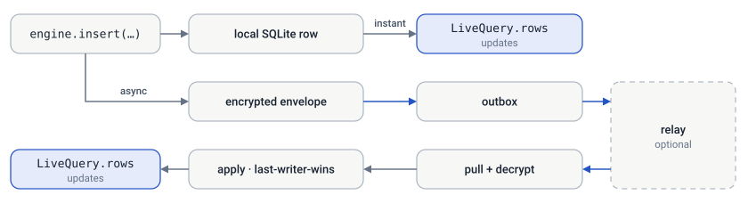

# Client API — Swift

The Swift client is a **full engine**, not just the protocol core. Like
`@simplysync/engine`, it owns a local SQLite database, a typed schema, the HLC
clock, the outbox, a reactive query cache, and the sync loop — so you call
`insert` / `update` / `query` and bind reactive results into SwiftUI, the same way
the React version works. It ships as the repository-root
[`SimplySync` Swift package](../../Package.swift); the
[`apps/todolist/swift`](../../apps/todolist/swift/README.md) todo
client compiles the same root `Sources/SimplySync/` tree.

> This page mirrors the [React/TypeScript guide](./guide.md) section-for-section.
> For the on-the-wire protocol and the identity interop boundary, see
> [Native clients](./native.md). Pure Foundation + CryptoKit + `SQLite3` — no
> third-party dependencies.

> **Looking something up?** Jump to the [API reference](#api-reference) or [Common pitfalls](./pitfalls.md).

## Mental model

- **The local SQLite database is the source of truth.** Reads come from it; writes
  land in it first, so the app is fully usable offline.
- **Every write also produces an encrypted sync event.** The engine queues it in a
  local outbox and pushes it when a relay is configured and reachable.
- **Sync is automatic and opportunistic.** The engine polls, pushes the outbox,
  pulls remote events, decrypts them, and applies them last-writer-wins. You
  rarely call `sync()` yourself.
- **Queries are reactive.** A `LiveQuery` republishes its rows when the data it
  depends on changes — from a local write *or* an incoming sync.



## Setup

### Clone the engine source

Use the `swift` selective clone preset:

```sh
bun run clone swift ../my-swift-sync
```

Add `../my-swift-sync` as a local package in Xcode and select the `SimplySync`
product, then:

```swift
import SimplySync
```

The engine is pure Foundation + Combine + CryptoKit + `SQLite3` (in the
iOS/macOS SDK), so there are no external dependencies and it also runs on
macOS. The [Swift source README](../../apps/todolist/swift/README.md#clone-and-use-the-source)
shows the manifest declaration.

### Define a schema

A schema is `{ table: { column: Column } }`. Column types come from the engine's
typed DSL and double as runtime validators.

```swift
let appSchema = Schema([
    "category": [
        "id": .id("category"),
        "name": .nonEmptyString,
    ],
    "entry": [
        "id": .id("entry"),
        "description": .nonEmptyString,
        "amountCents": .finiteNumber,
        "categoryId": .nullable(.id("category")), // nullable foreign key
    ],
])
```

You declare `id` per table. The engine adds three **system columns** to every
table automatically: `createdAt`, `updatedAt` (ISO/HLC strings), and `isDeleted`
(a `0 | 1` SQLite boolean). You never write `CREATE TABLE` — the engine derives it.

**Built-in column types:** `.string`, `.nonEmptyString`, `.nonEmptyString1000`,
`.positiveInt`, `.finiteNumber`, `.sqliteBoolean`, `.simpleName`, `.mnemonic`, and
`.id("Table")`. Wrap any with `.nullable(...)` to allow `null`, or
`.maxLength(n, ...)` to bound a string. Each validates on write and rejects bad
values with a typed message.

### Create the engine

`createSync(deps)` takes the platform plumbing once, then returns a factory you
call with your schema and config — exactly like the TS `createSync(deps)(schema,
config)`.

```swift
let deps = SyncEngineDeps(
    makeDriver: { name in try SQLite3Driver(path: dbPath(name)) }, // platform SQLite (see Platform drivers)
    secureStorage: KeychainStorage(),                              // OS secret store (see Platform drivers)
    reloadApp: { /* re-evaluate app state after restore/reset */ })

let engine = createSync(deps)(appSchema, SyncEngineConfig(
    name: "my-app",
    transports: [], // local-only until you add a relay
    syncIntervalMs: 3000,                                   // poll cadence
    schemaVersion: 1))                                      // optional; default 1

await engine.ready // resolves once the DB is open and the owner is loaded
```

Keep `schemaVersion` at `1` for additive table and column changes. Only bump it
when payload meaning changes incompatibly. Older clients durably retain a newer
payload without partially applying it, then replay it after an upgraded app
declares support.

What's safe to change after release — adding columns, renaming, removing,
changing a type — is covered in [Schema evolution](./schema.md).

On first run the engine mints a new owner (a fresh `sf1_` recovery key, stored via
`secureStorage`). On later runs it loads the existing one.

### Platform drivers

The engine is platform-agnostic: you inject a SQLite driver and a secret store.

**`SqliteDriver`** — a thin synchronous wrapper over the platform's SQLite:

```swift
protocol SqliteDriver: AnyObject {
    func exec(_ sql: String, _ params: [SQLiteValue]) throws
    func select(_ sql: String, _ params: [SQLiteValue]) throws -> [SQLiteRow]
    func transaction<T>(_ body: () throws -> T) throws -> T
}
```

`SQLite3Driver(path:)` is the bundled libsqlite3 implementation (`":memory:"` for
tests). 

**`SecureStorage`** — stores the recovery secret in the OS secret store:

```swift
protocol SecureStorage: AnyObject {
    func getItem(_ key: String) -> String?
    func setItem(_ key: String, _ value: String)
    func removeItem(_ key: String)
}
```

`KeychainStorage()` is the default; `InMemorySecureStorage()` is for tests.

## State management

### Writing data

Mutations are synchronous against local SQLite and return a `MutationResult`. Each
also enqueues an encrypted envelope for sync — you don't manage that. Column values
are `[String: SyncValue]`, and Swift literals work directly.

```swift
// insert — the engine generates the id and system columns
let result = engine.insert("entry", [
    "description": "Coffee",
    "amountCents": -450,
    "categoryId": nil,
])
switch result {
case .ok(let id): print(id)
case .failure(let message): print(message)
}

// update — requires the id; updates only the fields you pass
_ = engine.update("entry", ["id": .string(id), "amountCents": -500])

// upsert — insert or update by id
_ = engine.upsert("entry", ["id": .string(id), "description": "Latte"])
```

**Deletes are soft.** Set the `isDeleted` system column and filter it out in your
queries:

```swift
_ = engine.update("entry", ["id": .string(id), "isDeleted": sqliteTrue])
```

Values are validated against the schema, so an invalid write returns
`.failure(message:)` rather than corrupting the row.

### Querying data

Build a query once with `createQuery` from SQL plus the row type to decode into
(any `Decodable` struct). Double-quote table names so the reactive cache knows
which writes affect the query.

```swift
struct EntryRow: Decodable, Identifiable {
    let id: String
    let description: String
    let amountCents: Double
    let categoryName: String?
}

let entriesQuery = engine.createQuery("""
    select e.id as id, e.description as description, e.amountCents as amountCents,
           c.name as categoryName
    from "entry" e
    left join "category" c on c.id = e.categoryId
    where e."isDeleted" = 0
    order by e."createdAt" desc
""", as: EntryRow.self)

let rows = engine.loadQuery(entriesQuery)     // one-shot read → [EntryRow]
let cached = engine.getQueryRows(entriesQuery) // cached snapshot
```

### Reactive queries in SwiftUI

`engine.liveQuery(query)` returns a `LiveQuery` — the Swift analog of React's
`useQuery`. It's an `ObservableObject` whose `rows` republishes on the main thread
whenever a local write or an incoming sync changes the data. The engine is itself
an `ObservableObject`, so `engine.syncState` drives status UI.

```swift
struct Ledger: View {
    @ObservedObject var engine: SyncEngine
    @StateObject private var entries: LiveQuery<EntryRow>

    init(engine: SyncEngine) {
        self.engine = engine
        _entries = StateObject(wrappedValue: engine.liveQuery(entriesQuery))
    }

    var body: some View {
        VStack {
            SyncBadge(state: engine.syncState)              // re-renders on sync state change
            Button("Add") {
                _ = engine.insert("entry", ["description": "Tea", "amountCents": -300])
            }
            List(entries.rows) { e in                        // re-renders on any relevant change
                Text("\(e.description): \(e.amountCents)")
            }
        }
    }
}
```

- **`engine.liveQuery(q)`** → a `LiveQuery<Row>`; read `.rows`. Updates on a local
  write *or* an incoming sync.
- **`engine.syncState`** — the current `SyncState` ([Syncing with a relay](#syncing-with-a-relay)), published for SwiftUI.
- **`engine.subscribeQuery(q) { … }`** — the low-level listener `liveQuery` wraps.

## Identity management

### The owner & recovery key

A user's whole account derives from one secret. The engine manages it through
`secureStorage` and exposes the owner:

```swift
let owner = await engine.appOwner        // AppOwner? (or engine.currentOwner, sync)
owner?.id          // public owner id used for relay routing
owner?.recoveryKey // the secret to back up — an sf1_ key or a 24-word phrase
owner?.writeKey    // bearer token presented to the relay (a capability)
owner?.mnemonic    // the 24-word phrase, if the owner was derived from one

// UX: reveal the phrase on demand instead of gating onboarding on it. Simply
// Finance for iOS keeps "Show Recovery Phrase" in Settings behind Face ID or
// the passcode (LAContext), shows "Authenticating…" while the prompt is up,
// then offers Hide and Copy. Copy to a local-only pasteboard item that expires
// after 60 seconds, and announce "Copied" to VoiceOver. Prompt the user to save
// it when they first turn on sync, since that's when it matters.
```

Surface `owner.recoveryKey` so the user can save it. It is the
**only** thing that can decrypt their data — lose it and the data is unrecoverable
by design. The engine keeps it in the Keychain, never in plain SQLite.

### Restore on a new device

Boot with the saved secret and sync from scratch:

```swift
try await engine.restoreAppOwner(recoveryKey)
// By default this refuses to wipe local data unless the relay confirms the owner
// has data, so a wrong key or an unreachable relay can't destroy what's here.
//
// UX, modelled on the Simply Finance iOS app's Restore screen:
// - Keep Restore disabled until the input looks complete (12 or 24 words, or an
//   sf1_ key), and trim it before passing it in.
// - When NWPathMonitor reports no network, say so up front and offer a backup
//   file instead, rather than letting the user wait for a timeout.
// - Set an `isRestoring` flag that turns the button into a ProgressView and
//   disables it, and let SwiftUI draw it before you await.
// - On failure, show a plain message ("That phrase isn't valid.") and keep what
//   the user typed so they can fix a word.
// - Once it returns, route straight into the app and float a small "Syncing your
//   data…" banner until the first sync settles, instead of a full-screen wait.
//   Writes made meanwhile are safe under last-writer-wins.
// - On Apple devices the phrase can arrive with no typing at all through iCloud
//   Keychain; see iCloud sync (icloud.md).

// Intentional switch to a new/empty owner. Offer it only as an explicit choice
// ("Start with an empty wallet") behind a confirmation.
try await engine.restoreAppOwner(recoveryKey, force: true)
```

### Reset to a new owner

Reset mints a brand-new owner and wipes local data. It is the most
destructive call in the engine — the new owner has never synced anywhere, so no
relay can give the old data back. It refuses unless a relay is confirmed to hold
a copy, throwing `EngineError.resetUnsafe` with the condition that failed
(unpushed changes, offline, no relay configured, relay holds nothing):

```swift
// UX: confirm first with a destructive alert whose copy says exactly what goes
// and what stays, e.g. "This removes the recovery phrase and local data from this
// device only. Encrypted relay data is not deleted and can be restored with the
// phrase." Show progress while it runs; reloadApp replaces the UI.
do {
    try await engine.resetAppOwner()
} catch {
    // Show the reason (`error.localizedDescription`), let the user copy their
    // recovery phrase or otherwise save the data, and only then force it.
    try await engine.resetAppOwner(force: true)
}
```

This port has no `exportDatabase` yet, so the backup step is the app's: the
refusal message is the prompt, and the app decides what "back up first" means on
that platform.

Both call your `reloadApp` afterward so the UI re-evaluates against the new owner.

## Syncing with a relay

### Connecting a relay & sync state

A relay is **optional** — without one the app is purely local-first. Configure one
(or several) via `transports`, at creation or at runtime:

```swift
engine.setTransports([Transport(url: "https://relay.example.com")])
```

Setting transports triggers an immediate sync and starts the background poller.
You can still force a sync (e.g. a "Sync now" button):

```swift
await engine.sync() // push the outbox, then pull + apply remote events
```

The engine also syncs opportunistically after local writes. Watch progress with
`engine.syncState` (`getSyncState()` for a synchronous read):

| `SyncState` | Meaning |
| --- | --- |
| `.initial` | Idle, nothing synced yet. |
| `.syncing` | A push/pull is in flight. |
| `.synced(lastSyncedAt:)` | Up to date. |
| `.notSynced(error:terminal:status:)` | Failed. |

A **terminal** failure (auth/quota/bad request — 400/401/403/413) won't fix itself
by retrying the same batch, so the engine backs the poller off (still retrying on
the next explicit `sync()`). A nonterminal `429` uses the same five-minute
backoff; network and 5xx errors retry at the normal cadence.

With multiple relays, every one receives a full copy of the outbox and
`syncState` stays `.synced` while **any** relay works. For the per-relay truth —
which relay is failing, and how full each one is against its per-owner storage
quota — use `getRelayStatuses()` (one `GET /v1/status` probe per relay):

```swift
for s in await engine.getRelayStatuses() {
    print(s.url, s.reachable, "\(s.usedBytes ?? 0)/\(s.quotaBytes ?? 0) bytes")
}
```

Use the same HTTPS relay URL on every platform, whether the relay runs on
Cloudflare or on your own server ([Self-hosting](./self-hosting.md)).

### Syncing through iCloud instead

On Apple platforms the log can live in the user's iCloud, with no relay to run.
Tell the engine how to build that transport, then list it like a relay:

```swift
engine.transportFactory = CloudKitTransport.factory(containerIdentifier: "iCloud.com.example.app")
engine.setTransports([Transport(url: CloudKitTransport.base)])
```

Add a relay URL to the same list to keep Android and web clients in sync. The
[iCloud sync](./icloud.md) page covers the entitlement, the Production schema
you must deploy before shipping, and how a second device gets the recovery
phrase without typing it.

## API reference

### Lifecycle

Build the engine, wait for it to open, and shut it down.

| Member | Signature | Notes |
| --- | --- | --- |
| `createSync` | `(SyncEngineDeps) -> (Schema, SyncEngineConfig) -> SyncEngine` | Wire deps once, then build. |
| `engine.ready` | `await engine.ready` | Resolves when DB open + owner loaded. |

### State

Writes land in the local database and sync on their own; queries read it.

| Member | Signature | Notes |
| --- | --- | --- |
| `engine.insert` | `(String, [String: SyncValue]) -> MutationResult` | Generates id + system columns. |
| `engine.update` | `(String, [String: SyncValue]) -> MutationResult` | Requires `id`; updates passed fields. |
| `engine.upsert` | `(String, [String: SyncValue]) -> MutationResult` | Insert or update by id. |
| `engine.createQuery` | `(String, [SQLiteValue] = [], as: Row.Type) -> Query<Row>` | Reusable typed query. |
| `engine.loadQuery` | `(Query<Row>) -> [Row]` | One-shot read. |
| `engine.getQueryRows` | `(Query<Row>) -> [Row]` | Cached snapshot. |
| `engine.liveQuery` | `(Query<Row>) -> LiveQuery<Row>` | Reactive result (`useQuery` analog). |
| `engine.subscribeQuery` | `(Query<Row>, () -> Void) -> () -> Void` | Low-level reactive primitive. |

### Identity

The owner, its recovery key, and moving it between devices.

| Member | Signature | Notes |
| --- | --- | --- |
| `engine.appOwner` | `await -> AppOwner?` | `{ id, recoveryKey, writeKey, mnemonic? }`. |
| `engine.restoreAppOwner` | `(String, force: Bool) async throws` | Restore from a key/phrase. |
| `engine.resetAppOwner` | `(force: Bool) async throws` | New owner, wipes local data. Refuses unless a relay is confirmed to hold a copy. |

### Sync

Relays, sync status, and diagnostics.

| Member | Signature | Notes |
| --- | --- | --- |
| `engine.setTransports` | `([Transport]) -> Void` | Set relays; triggers sync + polling. |
| `engine.sync` | `() async` | Push outbox, pull + apply. |
| `engine.syncState` / `getSyncState()` | `SyncState` | Reactive + synchronous status. |
| `engine.getRelayStatuses` | `() async -> [RelayStatus]` | Per-relay health + storage usage (live `GET /v1/status` probe per relay). |

## Differences from the React engine

- **Raw SQL, not Kysely.** `createQuery` takes a SQL string + a `Decodable` row
  type instead of a typed query builder. The reactive cache (table extraction,
  refresh-on-change) works the same way.
- **`LiveQuery` / `ObservableObject`, not hooks.** SwiftUI observes `LiveQuery.rows`
  and `engine.syncState` instead of `useQuery` / `useSyncState`.
- **Not ported:** encrypted DB export/import (snapshot), binary blobs, and the
  fluent index builder. The protocol, schema, mutations, queries,
  identity, relay sync, and LWW are all here.
- **Identity interoperates by `sf1_` key and phrase** — Swift uses the same
  SLIP-21 labels as the TS protocol (`"SimplySync"`); see the
  [interop boundary](./native.md#identity-derivation-the-interop-boundary).

---

**Next:** [Native clients](./native.md) (the cross-language map & interop
boundary) · [Sync & the relay](./sync.md) (the wire protocol the engine speaks).
