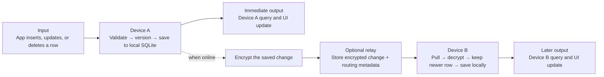

# SimplySync in one page

SimplySync is not a central database. **Every device has its own SQLite
database.** The app reads and writes that local database first, and SimplySync
optionally copies encrypted row changes to the same user's other devices.

> **The one idea to remember:** the local database is what the app uses. The
> relay is only a locked mailbox that helps devices exchange changes.

## The whole system

The local write finishes before the network is needed. Sync is background
delivery of a change that has already been committed on the originating device.
Devices restored with the same recovery key or phrase derive the identity and
encryption keys needed to exchange those changes.

## One concrete example

Suppose a user creates `todo/42` with the text **Buy milk** on device A.

1. The app asks SimplySync to save the row.
2. SimplySync validates the data, gives the row a version, saves it to the
   device's SQLite database, and remembers that it needs syncing.
3. The app's query reruns, so **Buy milk** appears immediately—even if the
   device is offline.
4. In the background, SimplySync encrypts the saved change. The relay stores and
   forwards it without seeing the todo text.
5. Device B pulls and decrypts the change, compares its version with any local
   copy, and saves it only if it is newer.
6. Device B's query reruns, and **Buy milk** appears there too.

At the end, both devices have their own local copy of `todo/42`. They did not
share a remote database connection; they exchanged an encrypted, versioned
change.

## Inputs → transformations → outputs

| Pipeline | Input | Transformation | Output |
| --- | --- | --- | --- |
| **Local write** | An insert, update, or delete | Validate → version → save locally → remember it needs syncing | Updated local database and immediate query/UI refresh |
| **Send** | A saved pending change | Encrypt on the device → upload when a relay is reachable | An unreadable encrypted change stored by the relay |
| **Receive** | An encrypted change from another device | Download → authenticate → decrypt → keep it only if newer | Updated local database and query/UI refresh on the receiving device |

For a delete, the change contains a versioned **deleted-row marker**. That lets
the deletion reach other devices and prevents an older copy from bringing the
row back.

## Who owns what

| Part | Responsibility |
| --- | --- |
| **The app** | Defines the schema and business rules, issues writes, and renders query results. |
| **SimplySync on each device** | Owns local transactions, versioning, encryption, delivery, conflict resolution, and reactive queries. |
| **The relay** | Routes and stores encrypted changes plus limited metadata. It is transport, not the source of truth or an application server. |

## What happens when things go wrong?

- **The device is offline or the relay is down:** local reads and writes still
  work. Committed changes remain queued and sync can retry later.
- **Two devices edit the same row:** the row with the newer version stamp wins.
  SimplySync replaces the whole row; it does not merge individual fields.
- **There is no relay configured:** SimplySync behaves as a local reactive
  database; cross-device delivery is simply absent.
- **The recovery key is lost:** another device or restored installation cannot
  reconstruct the cryptographic identity needed to decrypt the synced data.

## In one sentence

**Local input → validated and versioned SQLite state → encrypted delivery → keep
the newer row → local query and UI output.**

For more detail, continue with the [one-row walkthrough](./walkthrough.md), the
[pipeline matrix](./matrix.md), or the [implementation reference](./pipelines.md).
